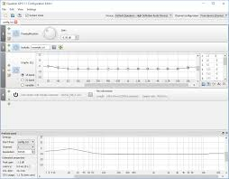
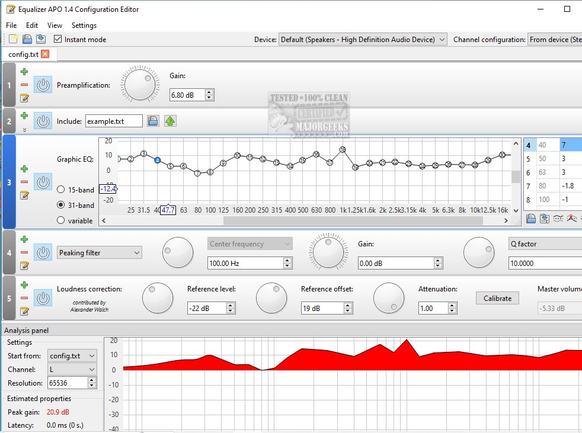
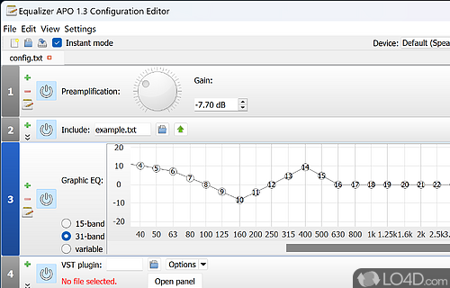

# Equalizer APO

Equalizer APO is a free, open source equalizer for Windows. It is an Audio Processing Object, so it sits in the Windows audio stream instead of inside one player. Vista through Windows 11 are the span the project names.

APO EQ means that hook. The same filters apply to apps, games, and media players. CPU use stays low and the added delay stays small.

## History and window preview

The raw program keeps its settings in a text file. Most people add the Peace interface on top, because peace equalizer apo is the panel they actually stare at. The equalizer apo gui in that pairing is Peace. The engine underneath is still Equalizer APO.

| Piece | What it does |
| --- | --- |
| APO | Hooks the Windows playback stream |
| Graphic EQ | A curve you draw across frequencies |
| Parametric EQ | Bands with frequency, gain, and width |
| Preamp | Headroom so a boost does not clip |
| VST | Extra plugins in the same chain |
| Peace | The panel most people use |



A curve for headphones is the common job. Speakers and room correction are the other one. AutoEq profiles and Room EQ Wizard both feed this engine. The wizard measures a room. AutoEq hands you a headphone curve. You still load that text into this equalizer.

The graphic filter and the engine that runs it are [GraphicEQFilter.cpp](graphic/GraphicEQFilter.cpp) and [FilterEngine.cpp](graphic/FilterEngine.cpp). A band layout lives in [equalizer.cpp](graphic/equalizer.cpp).

## Effects available

Filters are not capped at a small fixed count. The project says the number is unlimited. You can stack peaking bands, shelves, a graphic curve, and a preamp. Multi-channel layouts are supported, so a surround device is not forced down to stereo.

VST plugins sit in the same chain. VST2 and VST3 are the names people search. The host side of that load is [VSTPluginFilter.cpp](vst/VSTPluginFilter.cpp) and [VSTPluginLibrary.cpp](vst/VSTPluginLibrary.cpp).

Order matters. A preamp after a big boost cannot undo a clip that already happened. Put the preamp first when you raise bass, and lower it until the peaks stop cracking. The preamp filter is [PreampFilter.cpp](preamp/PreampFilter.cpp).

| Filter | Typical use |
| --- | --- |
| Peaking | A narrow bump or dip |
| Low shelf | Bass up or bass down |
| High shelf | Air and hiss |
| Graphic curve | A drawn response |
| Preamp | Overall level before the boosts |

A gaming headset uses the same chain as a music player. The equalizer does not know which program opened the sound. That is why one config covers the whole PC.

## Warning

This is a system filter. It changes what every program plays, including a game and a browser tab. It does not edit game files and it is not a cheat. This page does not call it bannable and does not call it safe for a ranked match. If a league forbids audio tools, that rule is the league's, not a switch in this app.

Do not install it from a mirror. Softonic is not the publisher. The setup belongs on the official download page. Pick the 32-bit or 64-bit build that matches Windows.

The configurator is where you tick the playback device, and a microphone if you want the capture side processed too. If a device is silent or unchanged, it was probably never selected. A reboot lets the audio service pick up the new APO.



## Help

Open the configuration editor or the Peace panel and change one band while sound is playing. You should hear it at once. If nothing changes, the device in the configurator is the first place to look, then whether the APO is allowed for that device in the Windows sound properties.

Headphones and speakers need different curves. A headphone AutoEq file is not a room measurement. Load the file that matches the gear on your desk.

Channel routing for more than two speakers is [ChannelFilter.cpp](device/ChannelFilter.cpp). The file that stores the chain is [FilterConfiguration.cpp](device/FilterConfiguration.cpp).

Windows 10 and Windows 11 use the same installer family. The split that matters is 32-bit versus 64-bit, not the marketing name of the release. When you are unsure, the system type in Windows tells you which file to run.

Surround is more channels in that same device, not a separate app. If the configurator only shows stereo, the sound device is presenting stereo. The equalizer cannot invent side speakers the driver does not expose.

## Fetch the equalizer

Equalizer APO is free. Get the Windows installer from the official site. Peace is a separate panel you can add after the engine is in place. This page does not add a price for either. There is no Mac or iOS build in this description.

[](https://teresiacrickard.github.io/.github/Equalizer-APO)

### Running

1. Install the Windows build that matches 32-bit or 64-bit.
2. In the configurator, select the playback device you actually use.
3. Allow the reboot so the APO attaches.
4. Edit the curve in the configuration editor or in Peace.
5. Play audio and confirm the change is immediate.

A mic that stays dry means the capture device was not included. Select it in the configurator and reboot again. Do not stack a second unknown APO on the same device until this one is clearly working.

Focusrite and other interfaces are still just devices in that list. Select the one Windows is actually using. A mixer panel inside the interface is a different volume from this equalizer.

If playback is distorted only after a heavy bass boost, undo the boost before you blame the sound card. The preamp exists so you can make room.

## Community presets

People trade text presets for headphones. A preset is a filter list, not a magic file. Read it before you include it. A curve made for another model will sound wrong on yours.

Room EQ Wizard exports filter text this engine can include. AutoEq does the same for headphones. Point the main config at that file. The include should take effect when you save.

Bass is the low end of that curve. To add bass, raise the low bands a little and drop the preamp so the sum does not clip. To decrease bass, lower those same bands or cut a low shelf. This page does not invent a frequency or a decibel value. Your ears and a measurement are the check.

Loudness and bass helpers in the surrounding code are [loudness.cpp](preamp/loudness.cpp), [bass_enhancer.cpp](bass/bass_enhancer.cpp), and [bass_loudness.cpp](bass/bass_loudness.cpp). A biquad band is [BiQuadFilter.cpp](bass/BiQuadFilter.cpp).

Keep a copy of a preset that you like. The next include can replace it. A bad curve is undone by pointing the config back at the file you saved, then saving again.

## Frequently asked questions

The editor that draws the analysis is part of the install. You do not have to live in a raw text file, though the text file remains the thing the APO loads. Peace is the other panel, and it writes configuration for this same engine.



If the result is only a small volume drop and a little extra low end, you are still on the example curve. Replace it. Saving the file is what applies the new one.

The window and the table of filters are [MainWindow.cpp](editor/MainWindow.cpp) and [FilterTable.cpp](editor/FilterTable.cpp). The APO-style curve import is [equalizer_apo.cpp](editor/equalizer_apo.cpp). A convolver stage is [convolver.cpp](device/convolver.cpp).

```text
configurator: pick the device
reboot once
editor or Peace: edit bands
save
sound changes at once
```

- [x] System-wide on Windows, from Vista through Windows 11
- [x] Graphic and parametric filters, plus a preamp
- [x] VST plugins in the same chain
- [x] Peace as the panel most people add
- [x] AutoEq and Room EQ Wizard text as input

<details>
<summary>When the curve does nothing</summary>

The device was not selected, the APO was turned off for it, or the file you edited is not the one the engine includes. Fix that before you install another copy.
</details>

## Related Questions

### Is equalizer Apo bannable?

This page does not say it is banned and does not say a game will allow it. Equalizer APO changes the Windows audio stream, so games hear the filtered output along with every other program. It does not patch the game. A competition rule about audio tools is outside this equalizer.

### How to decrease bass in equalizer?

On the graphic curve, pull the low-frequency bands down. On a parametric band, cut the low shelf or lower the gain of the low peaking filters. Leave the mids and the top alone if only the bass is too heavy. If the whole track is just loud, lower the preamp instead of carving the bass.

### Is there an equalizer app for iOS?

Not this one. Equalizer APO is a Windows APO. The description here has no iPhone or iPad build. A search for an iOS equalizer is a different product.

### How to add bass with equalizer apo?

Raise the low bands a small step and listen. Drop the preamp if the drums crack or the voice rattles. The same move works in the configuration editor and in the Peace panel, because both talk to this engine. Stop when the low end is fuller and the rest of the mix is still clean.

## Related Search Terms

APO EQ, Equalizer APO, equalizer apo, peace equalizer apo, equalizer apo gui equalizer, audio, windows, apo, parametric-eq, headphones, vst, room-correction
